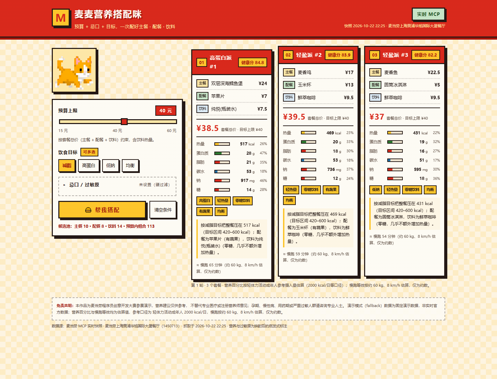

# 麦麦营养搭配咪 🐱🍔

> 一只傲娇的像素橘猫，帮你在麦当劳预算内配出 3 套「主餐 + 配餐 + 饮料」的健康组合。

「麦麦营养搭配咪」是面向**麦当劳程序员创意开发大赛**的 Skill 作品：它调用麦当劳 MCP Server 的真实菜单与营养数据，
在用户给定的**预算上限 / 忌口与过敏原 / 饮食目标**三重约束下，生成 3 个可执行的套餐组合，并给出健康评分、搭配理由、
营养占比与慢跑等效。没有配置 MCP Token 时，自动切换为**演示模式**，保证任何人在离线环境也能立刻体验。



---

## 目标用户

| 人群 | 真实痛点 | 本作品给什么 |
|---|---|---|
| 减脂期上班族 | 想吃得轻，但不知道套餐加起来多少卡 | 按热量区间评分，直接给出「轻热量」组合 |
| 健身增肌人群 | 只盯蛋白质，忽略钠和糖 | 蛋白质密度 + 脂肪供能比 + 钠糖上限综合打分 |
| 预算敏感的学生 | 想吃饱又想省钱 | 按套餐**总价**硬约束，超预算组合直接出局 |
| 有过敏原 / 忌口的人 | 「尽量避开」等于没避开 | 过敏原与忌口**硬过滤**，命中即整条商品出局 |
| 只想快速决定的人 | 选择困难 | 一次 3 选 1，点一下换一批 |

---

## 功能一览

1. **输入**：预算上限（15–60 元滑块）、饮食目标（减脂 / 高蛋白 / 低钠 / 均衡，可多选）、过敏原 9 项、忌口 9 项。
2. **输出 3 个套餐**，每个都是「主餐 + 配餐 + 饮料」的完整组合，不是三个单品。
3. **硬过滤**：过敏原与明确忌口命中即出局；预算按**套餐总价**约束（饮料计入总价与营养）。
4. **健康评分**：热量 / 蛋白质 / 脂肪 / 钠 / 糖 / 结构六个维度加权，权重与公式见 [MCP_INTEGRATION.md](./MCP_INTEGRATION.md)。
5. **轮换**：每次点击「帮我搭配」在约束不变前提下换一批，优先排除最近 9 个已展示组合；候选不足时提示放宽预算或忌口。
6. **卡片信息**：名称、组合内容与单价、套餐总价、热量、蛋白质、脂肪、碳水、钠、糖、健康标签、搭配理由、慢跑等效。
7. **计算假设明示**：营养百分比按轻体力活动成年人 2000 kcal/日等参考口径估算；慢跑按约 60 kg、8 km/h 估算，均为约数。
8. **三态 + 模式标识**：加载态、错误态、空结果态；右上角常驻「实时 MCP / 演示模式」徽章，页脚有完整免责声明。

---

## 快速开始

### 方式 A：直接看效果（零配置，演示模式）

```bash
git clone <your-repo-url>
cd maimai-nutrition-mi
# 直接用浏览器打开即可，无需服务器
start index.html      # macOS: open index.html
```

双击 `index.html` 就能用：`data/*.js` 是 JSON 数据的镜像文件，专门为 `file://` 协议准备。
此时右上角会显示 **演示模式**，数据为固定快照，非实时官方数据。

### 方式 B：接入真实 MCP（实时模式）

1. 在 [open.mcd.cn/mcp](https://open.mcd.cn/mcp) 申请 MCP Token；
2. 在 WorkBuddy 的【连接器 → 自定义连接器 → 配置 MCP】填入：

```json
{
  "mcpServers": {
    "mcd-mcp": {
      "type": "streamablehttp",
      "url": "https://mcp.mcd.cn",
      "headers": { "Authorization": "Bearer YOUR_MCP_TOKEN" }
    }
  }
}
```

3. 把 `YOUR_MCP_TOKEN` 换成真实 Token 并启用连接器；
4. 在 WorkBuddy 里说一句：「用麦麦营养搭配咪，刷新上海人民广场附近的菜单快照」——
   Skill 会依次调用 `query-nearby-stores` → `query-meals` → `list-nutrition-foods`，写入 `data/mcp_snapshot.json`，
   再跑一次 `python tools/build_data.py` 生成前端可读的镜像；
5. 重新打开 `index.html`，徽章变为 **实时 MCP**，并显示门店名与抓取时间。

> 详细调用序列、字段映射与失败降级规则见 [MCP_INTEGRATION.md](./MCP_INTEGRATION.md)。

---

## 使用示例

**示例 1：减脂 + 预算 40 元**

> 预算 40 元 → 目标「减脂」→ 点【帮我搭配】

得到类似：`板烧鸡腿堡 ¥23.5 + 苹果片 ¥7 + 纯悦 ¥7.5 = ¥38`
热量 423 kcal（占 2000 kcal 参考值 21%）、蛋白质 23 g、钠 1041 mg，标签「轻盈派」「零糖饮料」「有蔬果」。

**示例 2：乳制品过敏 + 不吃油炸**

> 勾选过敏原「牛奶/乳制品」、忌口「油炸」→ 预算 45 元

含芝士、奶铁、冰淇淋的商品被整体剔除；麦香鸡、薯条、麦乐鸡也不再出现，系统只在可行组合里排序。

**示例 3：预算压到 12 元**

> 滑块拉到 15 元以下不可能的区间（示例为演示最低价校验）

空结果态会明确告诉你「所有组合都超支」，并给出**当前最低可行组合与价格**（例如 `汉堡包 + 苹果片 + 纯悦 ≈ ¥21.5`），
而不是只弹一句「没有结果」。

---

## 项目结构

```
maimai-nutrition-mi/
├── SKILL.md                  # WorkBuddy Skill 入口：触发词、MCP 调用与刷新流程
├── README.md                 # 本文件
├── MCP_INTEGRATION.md        # MCP 工具、调用链、字段映射、评分公式、降级策略
├── CONTEST_DECLARATION.md    # 官方参赛声明（原文，未改动）
├── index.html                # 像素风单页应用
├── css/style.css             # 麦当劳配色像素样式
├── js/
│   ├── data.js               # 数据加载、模式判定、标签推导
│   ├── filter.js             # 过敏原 / 忌口硬过滤
│   ├── combo.js              # 主餐×配餐×饮料组合 + 总价约束
│   ├── score.js              # 健康评分（权重与公式集中在此）
│   ├── cat.js                # 猫咪气泡调度（8–15 秒随机）
│   └── app.js                # 交互编排、三态、轮换
├── data/
│   ├── mcp_snapshot.json     # MCP 抓取快照（真实数据，含门店与时间戳）
│   ├── fallback_data.json    # 演示数据（由快照固化，明确标注非实时）
│   ├── allergen_map.json     # 过敏原/忌口关键词映射（MCP 未提供该字段）
│   ├── cat_lines.json        # 猫咪语料
│   └── *.js                  # 上述 JSON 的浏览器镜像（build_data.py 生成）
├── assets/pixel-cat-walk.gif # 像素橘猫动图
├── tools/build_data.py       # 数据校验 + fallback 派生 + 镜像生成
└── tests/
    ├── run_tests.mjs         # Node 自动化测试（22 条）
    └── test.html             # 浏览器自测页
```

---

## 测试

```bash
# Node 自动化测试（无第三方依赖）
node tests/run_tests.mjs

# 数据校验 + 重新生成镜像
python tools/build_data.py

# 浏览器测试页
start tests/test.html
```

当前状态：**22 / 22 通过**，覆盖模式判定、过敏原零泄漏、预算约束、组合结构、评分单调性、
多目标区间交集、轮换不重复、空结果提示。测试计划见 [tests/TEST_PLAN.md](./tests/TEST_PLAN.md)。

---

## 已知边界（诚实说明）

- **过敏原不是官方字段**：MCP 的 `list-nutrition-foods` 不返回过敏原，本项目用 `data/allergen_map.json` 的
  名称关键词做保守映射，可能误判或漏判。严重过敏请以门店与包装标注为准。
- **糖是折算值**：接口只给碳水化合物，`sugarG` 按碳水折算并标记 `sugarEstimated`。
- **慢跑等效是粗略估算**：按 60 kg、8 km/h、约 8 kcal/min 折算，个体差异很大。
- **不做医疗建议**：本作品不提供诊断、治疗或用药建议，营养建议不替代注册营养师。
- **演示数据非实时**：`fallback_data.json` 为一次抓取的固化副本，价格与供应可能已变化。

---

## 合规与声明

- 参赛声明：[CONTEST_DECLARATION.md](./CONTEST_DECLARATION.md)（官方原文，未做任何修改）
- 本项目未使用任何麦当劳商标图形资产，仅使用红黄配色做致敬；猫咪素材为活动方提供的像素动图。
- 所有营养与价格数据均来自麦当劳 MCP 公开接口或明确标注的演示数据，不伪造「官方实时营养数据」。

## License

MIT（代码部分）。数据版权归麦当劳中国所有，本项目仅用于赛事演示。
